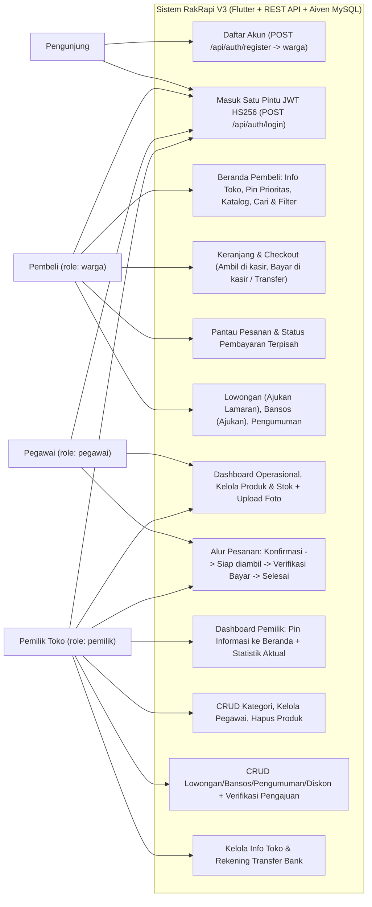
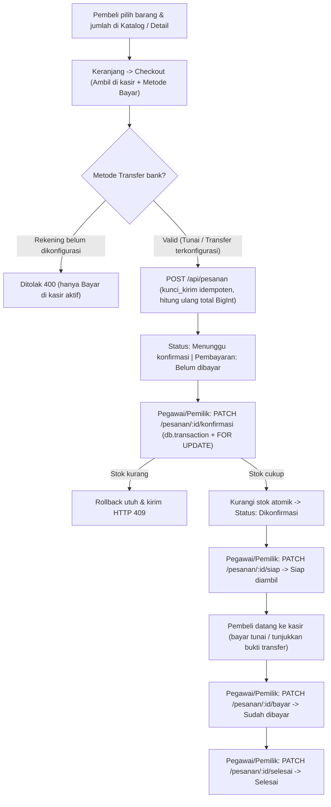
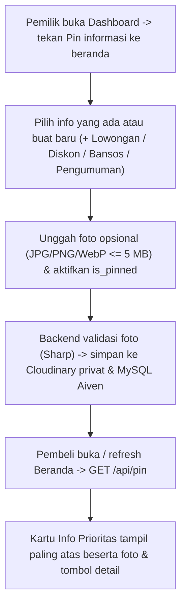
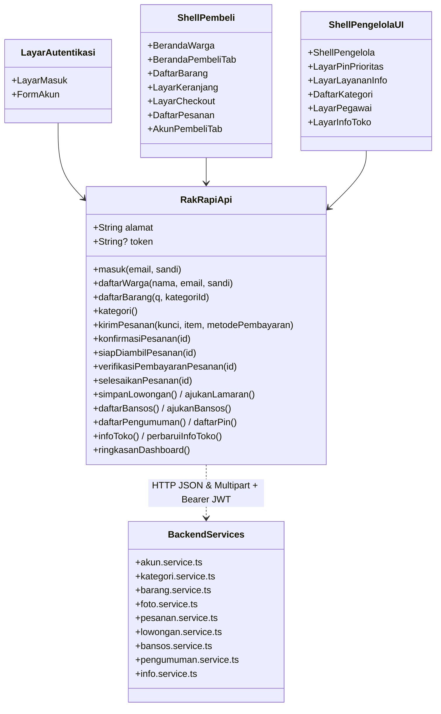

# Diagram Sistem dan Pengujian Blackbox — RakRapi (V3)

> **Disinkronkan dengan implementasi akhir V3:** 22 November 2026 (`codex/ui-env-pixel8`)  
> **Pengembang:** Muhammad Kaysan Ashraf — XI RPL 5 — SMK Taruna Bhakti (Uji Level KOKE & MAPIL 2026/2027)  
> **Arsitektur aktif:** Flutter (Android) → REST API Express.js + TypeScript + Drizzle ORM (1 pool `db`, 1 file `.env`, JWT HS256 1 jam, `bcryptjs`, Cloudinary privat) → MySQL 8 (Aiven `TLSv1.3` & Laragon lokal).

---

## 1. Entity Relationship Diagram (ERD — 11 Tabel & 8 Foreign Key)

Migrasi non-destruktif `07_v3_fitur.sql` mempertahankan seluruh 6 tabel inti (`users`, `kategori`, `barang`, `lowongan`, `pesanan`, `detail_pesanan`), Primary Key, Foreign Key, stored procedure `tambah_pegawai`, serta seluruh data asli, dan menambahkan 5 tabel fitur Prototype V3 (`lamaran`, `program_bansos`, `pengajuan_bansos`, `pengumuman`, `info_toko`).

```mermaid
erDiagram
    users {
        INT id PK "AUTO_INCREMENT UNSIGNED"
        VARCHAR nama "NOT NULL (100)"
        VARCHAR email UK "NOT NULL UNIQUE (255)"
        VARCHAR password_hash "NOT NULL (255, bcryptjs)"
        VARCHAR role "NOT NULL DEFAULT warga (pemilik|pegawai|warga)"
        ENUM status "NOT NULL DEFAULT aktif (aktif|diberhentikan)"
        VARCHAR alasan_pemberhentian "NULL (500)"
        DATETIME diberhentikan_pada "NULL"
    }

    kategori {
        INT id PK "AUTO_INCREMENT UNSIGNED"
        VARCHAR nama UK "NOT NULL UNIQUE (100)"
    }

    barang {
        INT id PK "AUTO_INCREMENT UNSIGNED"
        INT kategori_id FK "NOT NULL -> kategori.id (ON DELETE RESTRICT)"
        VARCHAR nama "NOT NULL (150)"
        INT harga_rupiah "NOT NULL UNSIGNED"
        DECIMAL stok "NOT NULL (12,3; kg pecahan, lainnya bulat)"
        VARCHAR satuan "NOT NULL (botol|kg|pcs|bungkus|pack|sisir|kotak|lembar|sachet)"
        VARCHAR deskripsi "NOT NULL DEFAULT '' (500)"
        VARCHAR foto_key "NOT NULL (255, UUID.png/.jpg/.webp)"
    }

    pesanan {
        INT id PK "AUTO_INCREMENT UNSIGNED"
        INT warga_id FK "NOT NULL -> users.id (ON DELETE RESTRICT)"
        VARCHAR nama_pemesan "NOT NULL (100)"
        CHAR kunci_kirim UK "NOT NULL (32, UNIQUE bersama warga_id)"
        ENUM status "Menunggu konfirmasi|Dikonfirmasi|Siap diambil|Selesai"
        ENUM metode_pembayaran "Bayar di kasir|Transfer bank"
        ENUM status_pembayaran "Belum dibayar|Sudah dibayar"
        DECIMAL total_rupiah "NOT NULL (32,0)"
        DATETIME dibuat "NOT NULL DEFAULT CURRENT_TIMESTAMP"
    }

    detail_pesanan {
        INT id PK "AUTO_INCREMENT UNSIGNED"
        INT pesanan_id FK "NOT NULL -> pesanan.id (ON DELETE RESTRICT)"
        INT barang_id FK "NULL -> barang.id (ON DELETE SET NULL)"
        VARCHAR nama_barang "NOT NULL (150)"
        VARCHAR satuan "NOT NULL (20)"
        DECIMAL jumlah "NOT NULL (12,3)"
        INT harga_rupiah "NOT NULL UNSIGNED"
    }

    lowongan {
        INT id PK "AUTO_INCREMENT UNSIGNED"
        VARCHAR judul "NOT NULL (150)"
        VARCHAR deskripsi "NOT NULL (1000)"
        VARCHAR persyaratan "NOT NULL (1000)"
        VARCHAR lokasi "NOT NULL (150)"
        VARCHAR info_tambahan "NOT NULL (150)"
        VARCHAR foto_key "NULL (255)"
        BOOLEAN aktif "NOT NULL DEFAULT true"
        BOOLEAN is_pinned "NOT NULL DEFAULT false"
        DATETIME dibuat "NOT NULL DEFAULT CURRENT_TIMESTAMP"
    }

    lamaran {
        INT id PK "AUTO_INCREMENT UNSIGNED"
        INT lowongan_id FK "NOT NULL -> lowongan.id (ON DELETE CASCADE)"
        INT warga_id FK "NOT NULL -> users.id (ON DELETE RESTRICT)"
        VARCHAR nama_pelamar "NOT NULL (100)"
        VARCHAR keterangan "NOT NULL (1000)"
        ENUM status "Menunggu verifikasi|Disetujui|Ditolak"
        DATETIME dibuat "NOT NULL DEFAULT CURRENT_TIMESTAMP"
    }

    program_bansos {
        INT id PK "AUTO_INCREMENT UNSIGNED"
        VARCHAR nama "NOT NULL (150)"
        VARCHAR deskripsi "NOT NULL (1000)"
        VARCHAR jenis_bantuan "NOT NULL (150)"
        VARCHAR persyaratan "NOT NULL (1000)"
        INT kuota "NOT NULL UNSIGNED CHECK >= 1"
        VARCHAR foto_key "NULL (255)"
        BOOLEAN aktif "NOT NULL DEFAULT true"
        BOOLEAN is_pinned "NOT NULL DEFAULT false"
        DATETIME dibuat "NOT NULL DEFAULT CURRENT_TIMESTAMP"
    }

    pengajuan_bansos {
        INT id PK "AUTO_INCREMENT UNSIGNED"
        INT program_id FK "NOT NULL -> program_bansos.id (ON DELETE CASCADE)"
        INT warga_id FK "NOT NULL -> users.id (ON DELETE RESTRICT)"
        VARCHAR nama_pemohon "NOT NULL (100)"
        VARCHAR keterangan "NOT NULL (1000)"
        ENUM status "Menunggu verifikasi|Disetujui|Ditolak"
        DATETIME dibuat "NOT NULL DEFAULT CURRENT_TIMESTAMP"
    }

    pengumuman {
        INT id PK "AUTO_INCREMENT UNSIGNED"
        VARCHAR judul "NOT NULL (150)"
        VARCHAR deskripsi "NOT NULL (1000)"
        ENUM jenis "Pengumuman|Diskon|Informasi toko"
        VARCHAR info_tambahan "NOT NULL (150)"
        VARCHAR foto_key "NULL (255)"
        BOOLEAN aktif "NOT NULL DEFAULT true"
        BOOLEAN is_pinned "NOT NULL DEFAULT false"
        DATETIME dibuat "NOT NULL DEFAULT CURRENT_TIMESTAMP"
    }

    info_toko {
        TINYINT id PK "CHECK (id = 1)"
        VARCHAR nama_toko "NOT NULL (150)"
        VARCHAR alamat "NOT NULL (300)"
        VARCHAR jam_operasional "NOT NULL (150)"
        VARCHAR kontak "NOT NULL (100)"
        VARCHAR info_pengambilan "NOT NULL (300)"
        VARCHAR nama_bank "NULL (100)"
        VARCHAR nomor_rekening "NULL (50)"
        VARCHAR nama_pemilik_rekening "NULL (150)"
        DATETIME diperbarui "NOT NULL"
    }

    kategori ||--o{ barang : "memiliki (fk_barang_kategori)"
    users ||--o{ pesanan : "membuat (pesanan_ibfk_1)"
    pesanan ||--|{ detail_pesanan : "memuat (detail_pesanan_ibfk_1)"
    barang ||--o{ detail_pesanan : "dirujuk (detail_pesanan_ibfk_2)"
    lowongan ||--o{ lamaran : "menerima (fk_lamaran_lowongan)"
    users ||--o{ lamaran : "mengajukan (fk_lamaran_warga)"
    program_bansos ||--o{ pengajuan_bansos : "menerima (fk_pengajuan_program)"
    users ||--o{ pengajuan_bansos : "mengajukan (fk_pengajuan_warga)"
```

> **Catatan Pin Prioritas:** Kolom boolean `is_pinned` berada langsung pada tabel asal (`lowongan`, `program_bansos`, `pengumuman`) sehingga endpoint `GET /api/pin` menggabungkan informasi terpin tanpa menduplikasi data.

---

## 2. Use Case Diagram (4 Aktor & Pembatasan Role JWT)

---

## 3. Activity Diagram

### A. Alur Pesanan, Pengurangan Stok, & Verifikasi Pembayaran (Ambil di Kasir)

### B. Alur Pin Informasi Prioritas Pemilik ke Beranda Pembeli

---

## 4. Class Diagram (Flutter V3 & Backend Express/Drizzle)

---

## 5. Tabel Hasil Pengujian Blackbox Aktual V3 (22 November 2026)

| No | Modul | Skenario Pengujian | Hasil yang Diharapkan | Hasil Aktual | Status |
|---:|---|---|---|---|---|
| 1 | Build Backend | `npm.cmd run build` (`tsc`) | Kompilasi TypeScript 0 error | Exit code 0, 0 error | **LULUS** |
| 2 | Migrasi & Idempotensi DB | Jalankan `07_v3_fitur.sql` + seed 2x pada DB isolasi, lalu terapkan ke Laragon & Aiven | 11 tabel terbentuk, 0 duplikasi saat seed ulang, ID 2 utuh, `defaultdb` & `money_tracker` utuh | Isolasi Run 1 = Run 2; Aiven & Laragon: 10 kategori, 18 produk, 3 lowongan, 2 bansos, 4 pengumuman, 1 info_toko; ID 2 utuh | **LULUS** |
| 3 | Autentikasi & 3 Role | Register warga (tolak injeksi role), login 3 role, sandi salah 401, token invalid 401, lintas role 403 | Role register selalu `warga`, JWT HS256 valid, endpoint terlarang 403 | Lulus di 12/12 suite `uji_backend_v3.cjs` & verifikasi live Aiven | **LULUS** |
| 4 | Kategori & Produk + Foto | CRUD kategori & produk, `?q=` & `?kategori_id=`, upload PNG/WebP, tolak file rusak 415, lindungi kategori terpakai 409 | Foto privat tersimpan & terbaca byte identik, edit teks tidak menghapus foto | Lulus di suite API isolasi & live Cloudinary Private (foto ID 2, produk baru, poster promo HTTP 200) | **LULUS** |
| 5 | Pesanan & Pembayaran | Tolak qty 0/>stok, tolak Transfer saat rekening kosong (400), idempoten `kunci_kirim`, konfirmasi paralel tanpa potong stok 2x, tolak Selesai sebelum lunas (409), verifikasi bayar → Selesai | Stok berkurang tepat sekali, status pesanan & pembayaran terpisah, alur transfer aktif setelah rekening dikonfigurasi | Lulus penuh di `uji_backend_v3.cjs` (Test 7 & Test 8) | **LULUS** |
| 6 | Lowongan & Lamaran | CRUD + foto + pin, ajukan lamaran, blokir duplikat (409) & lowongan tutup (409), review pemilik | Status `Menunggu verifikasi` → `Disetujui`/`Ditolak`, anti-duplikat DB UNIQUE | Lulus penuh di `uji_backend_v3.cjs` (Test 9) | **LULUS** |
| 7 | Bansos & Kuota | CRUD program kuota=1, ajukan 2 warga, tolak duplikat (409), setujui 1, tolak persetujuan ke-2 karena kuota penuh (409) | Kuota dijaga secara transaksional (`FOR UPDATE`), tanpa NIK/penghasilan fiktif | Lulus penuh di `uji_backend_v3.cjs` (Test 10) | **LULUS** |
| 8 | Pengumuman, Diskon & Pin | CRUD pengumuman & diskon berfoto, multi-pin lintas modul, lepas pin mempertahankan data asal, harga produk tidak berubah oleh diskon | `GET /api/pin` hanya menampilkan item terpin aktif, unpin menghapus dari beranda saja | Lulus di suite API & live Aiven (`2` item terpin tampil di beranda) | **LULUS** |
| 9 | Dashboard Statistik | `GET /api/dashboard` untuk pemilik/pegawai vs warga (403) | Seluruh angka berasal dari `COUNT(*)` SQL aktual | Lulus (`jumlah_produk: 18, jumlah_kategori: 10, jumlah_pegawai: 1, jumlah_pin_aktif: 2`) | **LULUS** |
| 10 | Flutter Analyze & Widget Tests | `flutter analyze --no-pub` & `flutter test --no-pub` | 0 issue lint, seluruh tes widget & sesi lulus | 0 issue; **20/20 tes Flutter lulus** (`sesi_test`, `tampilan_test`, `keranjang_test`, `form_barang_test`) | **LULUS** |
| 11 | E2E Emulator Pixel 8 (Live Aiven) | Jalankan `v3_emulator_bukti_test.dart` pada `emulator-5554` terhubung backend Aiven + Cloudinary | Login/Register V3, Beranda Pembeli, Katalog, Detail ID 2, Dashboard Pemilik, Pin Prioritas, Dashboard Pegawai tampil tanpa error & overflow | Terverifikasi pada `Pixel_8` (`docs/bukti/v3-pixel8/01..08.png`) | **LULUS** |
| 12 | Pemberhentian Pegawai | Pemilik melihat detail & memberhentikan pegawai dengan alasan wajib; cek login pegawai (403), token JWT aktif lama (401), pembeli/pegawai diblokir (403), pemilik/warga tidak bisa diberhentikan (403), riwayat akun tetap ada | Akun berubah status `diberhentikan`, alasan & tanggal tersimpan, akses dicabut seketika, akun tidak dihapus permanen | Lulus penuh di `uji_backend_v3.cjs` (Test 13/13) & `tampilan_test.dart` (21/21 `flutter test`) | **LULUS** |
| 13 | Pengujian HP Fisik | Uji koneksi ADB pada HP fisik | Diuji bila perangkat terpasang | Perangkat HP fisik tidak terhubung saat sesi pengujian ini | **BELUM TERUJI DI HP FISIK** |
