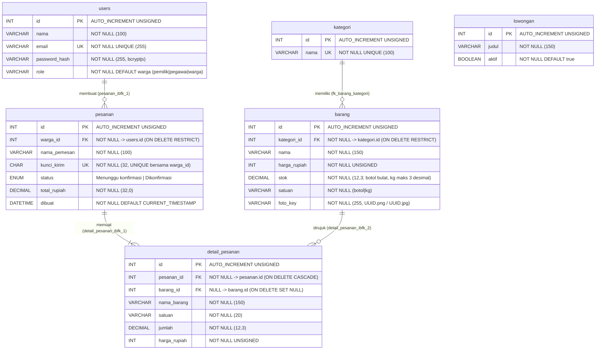
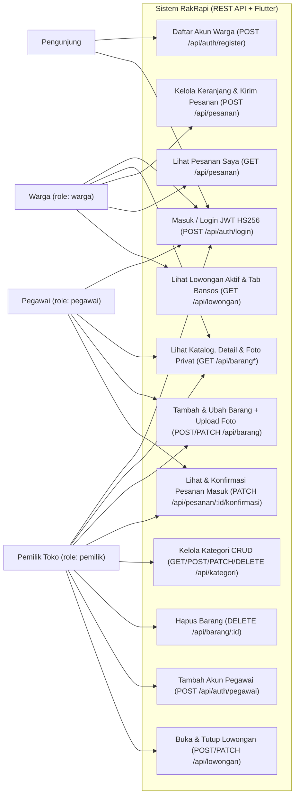
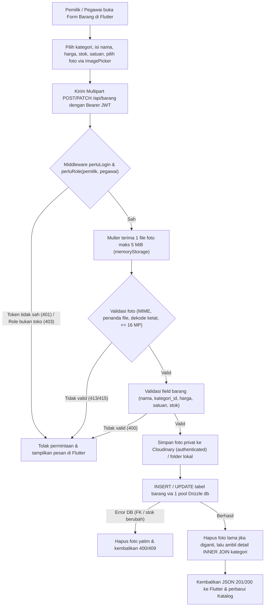
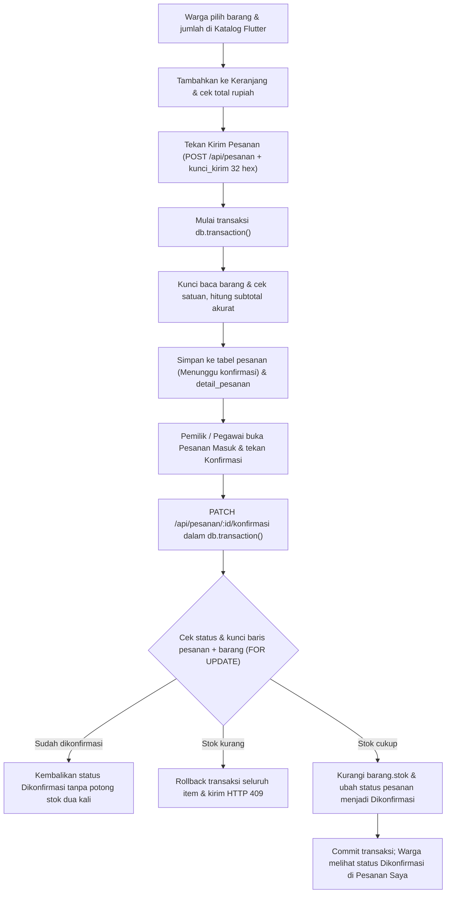
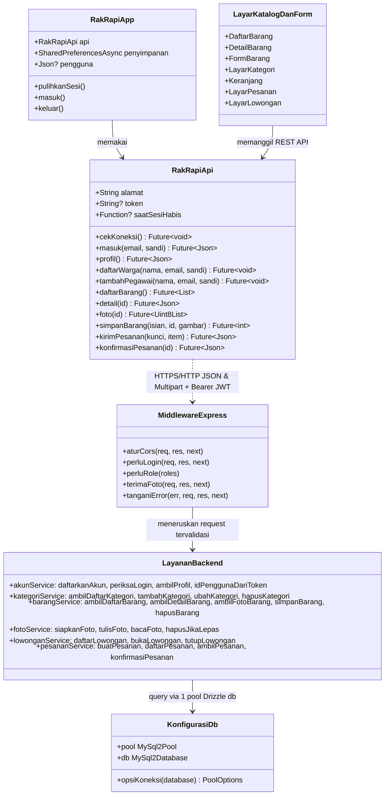

# Diagram Sistem dan Pengujian Blackbox — RakRapi

> **Disinkronkan dengan implementasi akhir:** 22 November 2026 (`codex/ui-env-pixel8`)  
> **Pengembang:** Muhammad Kaysan Ashraf — XI RPL 5 — SMK Taruna Bhakti (Uji Level KOKE & MAPIL 2026/2027)  
> **Arsitektur aktif:** Flutter (Android) → REST API Express.js + TypeScript + Drizzle ORM (1 pool `db`, 1 file `.env`, JWT HS256 1 jam, `bcryptjs`, Cloudinary privat) → MySQL 8 (Laragon lokal & Aiven `TLSv1.3`).

---

## 1. Entity Relationship Diagram (ERD — 6 Tabel & 4 Foreign Key)

Lampiran gambar ERD lengkap: [erd-rakrapi-lengkap.png](bukti/erd-rakrapi-lengkap.png).

> **Catatan Database:** Stored procedure `tambah_pegawai` tetap dipertahankan pada database Laragon dan Aiven (`04_prosedur_pegawai.sql`) sampai verifikasi materi Basis Data selesai.

---

## 2. Use Case Diagram (4 Aktor & Pembatasan Role JWT)

---

## 3. Activity Diagram

### A. Alur Tambah / Ubah Barang Beserta Upload Foto Privat

### B. Alur Pemesanan Warga hingga Konfirmasi Pengurangan Stok

---

## 4. Class Diagram (Backend Express/Drizzle & Frontend Flutter)

---

## 5. Tabel Hasil Pengujian Blackbox Aktual (22 November 2026)

Seluruh pengujian dijalankan terhadap backend hasil penyederhanaan (1 `.env`, 1 pool Drizzle `db`, 1 akun aplikasi `rakrapi_app`, JWT HS256 1 jam, Cloudinary privat) tanpa memodifikasi data asli:

| No | Modul | Skenario Pengujian | Hasil yang Diharapkan | Hasil Aktual | Status |
|---:|---|---|---|---|---|
| 1 | Build & Kualitas | `npm run build` (`tsc`) pada backend | Kompilasi TypeScript bersih tanpa error | Exit code 0, 0 error | **LULUS** |
| 2 | Kualitas Flutter | `flutter analyze --no-pub` & `flutter test --no-pub` | 0 issue analisis, seluruh tes widget & sesi lulus | 0 issue; **18/18 tes lulus** (`sesi_test`, `keranjang_test`, `form_barang_test`, `tampilan_test`) | **LULUS** |
| 3 | Koneksi Laragon | `GET /api/health` dengan 1 pool `db` (`rakrapi_app@localhost`, `DB_SSL=false`) | HTTP 200 `{"status":"ok","nama_database":"rakrapi"}` | HTTP 200 `{"status":"ok","nama_database":"rakrapi"}` | **LULUS** |
| 4 | Koneksi Aiven TLS | `GET /api/health` & `periksa-aiven.cjs` (`rakrapi_app@%`, `DB_SSL=true`, `DB_SSL_CA_BASE64`) | HTTP 200, `TLSv1.3`, `rejectUnauthorized: true`, hanya 6 tabel `rakrapi` terlihat | HTTP 200, `TLSv1.3`, `tls_terverifikasi: true`, 6 tabel `rakrapi`, `defaultdb` & `money_tracker` terisolasi | **LULUS** |
| 5 | Validasi TLS | Uji unit `test/koneksi.cjs` menolak Aiven dengan `DB_SSL=false`, CA kosong/invalid, port invalid | Melempar error sebelum membuka koneksi | 4/4 tes lulus (termasuk CORS `*` dan domain allowlist) | **LULUS** |
| 6 | Register Warga | `POST /api/auth/register` dengan `role: "pemilik"` di body & email duplikat | HTTP 201 dipaksa `role: "warga"`, duplikat HTTP 409, password di-hash `bcryptjs` | 201 `warga`, duplikat 409, `bcrypt.compare` cocok | **LULUS** |
| 7 | Login & JWT | `POST /api/auth/login` benar/salah pada Laragon & Aiven; uji 90 kasus HTTP di `test/jwt.cjs` | Login benar 200 (`HS256`, `exp=3600s`), sandi salah 401; token hilang/rusak/expired/`none`/secret salah/tanpa `exp` → 401 | **90/90 pemeriksaan HTTP JWT lulus**; login hash lama cost-10 tetap lulus | **LULUS** |
| 8 | Otorisasi 3 Role | Akses endpoint `/auth/pemilik`, `/auth/pegawai`, `/kategori`, `/barang`, `/lowongan`, `/pesanan` oleh 3 role + perubahan role langsung di MySQL | Pemilik 200/201, pegawai & warga 403 pada rute terlarang; perubahan role di MySQL langsung berlaku tanpa token baru | Seluruh matriks 200/201/403 lulus; role terbaru terbaca live dari MySQL | **LULUS** |
| 9 | CRUD Kategori | Pemilik tambah (201), duplikat (409), kosong (400), ubah (200), hapus kosong (204), hapus terpakai (409 `ON DELETE RESTRICT`) | Semua status tepat; kategori terpakai gagal dihapus | Seluruh skenario lulus; pesan penolakan 409 tampil tepat | **LULUS** |
| 10 | CRUD Barang & JOIN | Tambah barang berfoto (201), baca daftar/detail `INNER JOIN kategori` (200), ubah harga/stok tanpa ganti foto (200), ubah satuan/foto (200), hapus barang oleh pemilik (204) vs pegawai (403) | `nama_kategori` tampil dari `INNER JOIN`, foto lama utuh jika tidak diganti, foto terhapus saat barang dihapus | 5/5 rangkaian `test/katalog.cjs` lulus (termasuk pemulihan file yatim saat restart) | **LULUS** |
| 11 | Validasi & Foto Privat | Unggah PNG/JPEG valid, PNG korup, JPEG scan korup/kosong, MIME palsu, >5 MiB, >16 MP; baca foto ID 2 via Cloudinary privat pada Laragon & Aiven | Valid diterima byte identik; korup/palsu/>16 MP → 415; >5 MiB → 413; foto ID 2 privat 200 dengan SHA-256 identik | 4/4 `test/foto.cjs` lulus; foto ID 2 dari Cloudinary `2.200.991` byte SHA-256 identik (`D731582F...`) pada Laragon & Aiven | **LULUS** |
| 12 | Lowongan | Pemilik buka (201) & tutup (204), warga baca aktif saja (200), pegawai/warga kelola (403) | Lowongan tertutup hilang di daftar warga, tetap tercatat bagi pemilik | Lulus di `test/akun.cjs` | **LULUS** |
| 13 | Keranjang, Pesanan & Stok | Warga kirim pesanan (201, `kunci_kirim`), 2 petugas konfirmasi bersamaan (200, stok berkurang sekali), stok kurang (409 rollback utuh), lintas warga (404), harga lama tersimpan | Stok akhir akurat (`14→12` & `12.5→10`), tidak ada pengurangan ganda atau parsial, harga saat pesan tersimpan (`Rp19.000`, total `Rp73.000`) | Lulus penuh di `test/akun.cjs --uji-pesanan` | **LULUS** |
| 14 | Integritas Data Asli | Audit read-only Laragon, Aiven (`rakrapi`, `defaultdb`, `money_tracker`), stored procedure `tambah_pegawai`, 4 akun lama, foto lokal & backup | Data asli 100% utuh, proyek lain di Aiven tidak tersentuh | `users=4`, `kategori=1`, `barang=1` (ID 2 Rp19.000, 12 botol), `defaultdb` & `money_tracker` identik, `tambah_pegawai` utuh, SHA-256 foto lokal = backup = Cloudinary | **LULUS** |
| 15 | Konkurensi Foto & Transaksi | 10 baca foto paralel; edit harga + 6 baca foto paralel; ganti foto A→B + 8 baca foto paralel (tanpa `GET_LOCK`); 3 kirim pesanan identik (`kunci_kirim`); 3 konfirmasi pesanan serentak | Baca paralel 10/10 identik; edit harga tidak merusak foto; ganti foto berakhir konsisten 1 file foto B tanpa korup; pesanan tidak duplikat; stok terpotong tepat sekali (`10→7`) | 10/10 baca 200 identik; 6/6 baca saat edit harga 200 identik; ganti foto 200 (`8/8` fotoA, `0` race 404, `0` korup, akhir fotoB 1 file); `jumlahBarisPesanan=1`; stok akhir `7.000` | **LULUS** |
| 16 | Audit Layar, Tombol & Navigasi Flutter | Pemeriksaan seluruh 10 layar, seluruh tombol/navigasi, dan uji widget/sesi untuk 3 role (`main`, `katalog`, `form_barang`, `form_akun`, `kategori`, `keranjang`, `pesanan`, `lowongan`) | Tidak ada tombol mati/palsu; tab Bansos jujur menampilkan status disiapkan tanpa form palsu; seluruh alur 3 role bekerja | `flutter analyze` 0 issue; **18/18 `flutter test` lulus**; 0 tombol palsu/mati ditemukan | **LULUS** |
| 17 | Build Android Release APK | `flutter build apk --release` pada `frontend/` (tanpa `--no-pub` agar `GeneratedPluginRegistrant.java` bersih dari plugin test) | `app-release.apk` terbentuk utuh tanpa error kompilasi Gradle/Java | `app-release.apk` berhasil dibangun (**50,38 MB** / `52.826.453` byte; SHA-256 `42C7853212850B5C0378DCE672A608C188AEA5AE51318AA4FE974E2AA6F84929`; default `API_URL=http://127.0.0.1:3000/api`) | **LULUS** |
